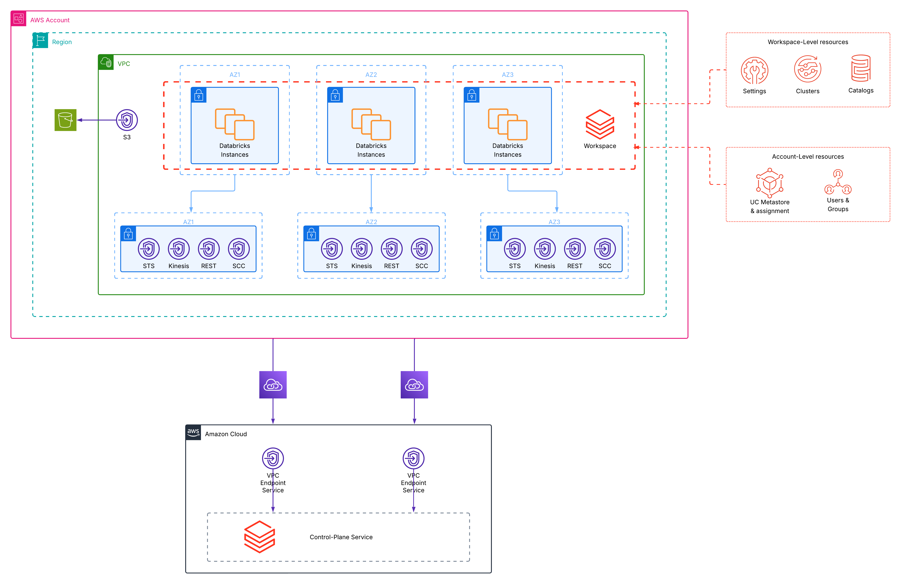

# aws-terragrunt-simple-mws

Simple terragrunt setup to deploy multiple isolated databricks workspaces with individual configurations for different
business-units, cloud-regions and environments.




### How-to
By default, the stack uses `AWS_PROFILE` to authenticate with AWS and environment variables to authenticate with Databricks.
You can change both according to your needs in the respective provider configurations. Follow the steps below to deploy this stack:

- Authenticate with your AWS Profile against your environment and make sure to set `AWS_PROFILE`. Alternatively, adjust the authentication method in the AWS provider configuration in `live/root.hcl`
- Set `DATABRICKS_ACCOUNT_ID`, `DATABRICKS_CLIENT_ID`, `DATABRICKS_CLIENT_SECRET` based on your service-principal used for deployments. Alternatively, adjust the authentication method in the Databricks provider configuration in `live/root.hcl`
- (Optional) Fill `aws_account_id` in all `environment.hcl` configuration files to match your environments.
- (Optional) Fill `databricks_account_admins` in `/live/../account-config/terragrunt.hcl` configuration file to add additional account-admins.
- Run the stack with
```shell

terragrunt plan --all --working-dir ./live
terragrunt apply --all --working-dir ./live
```

### Feature flags

Capabilities are toggled with boolean **feature flags** so you can enable or disable them per environment, region, or business unit without editing any module code.

A global baseline lives in `live/root.hcl` (`feature_baseline`). Each level of the hierarchy may optionally define its own flat `features = { … }` map, and these merge from least- to most-specific — so **the most-specific level wins**: `business-unit.hcl` overrides `region.hcl`, which overrides `environment.hcl`, which overrides the baseline (and an individual unit can still apply a final override). The `environment.hcl`, `region.hcl` and `business-unit.hcl` files already ship with empty `features = {}` stubs as ready-to-use override points along this chain.

```hcl
# e.g. in business-unit.hcl (or region.hcl / environment.hcl)
locals {
  features = {
    enable_serverless_connectivity = true   # only list the flags you want to change
  }
}
```

| Flag | Default | Purpose |
|------|:------:|---------|
| `enable_serverless_connectivity` | `false` | Network connectivity config (NCC) for serverless compute + its binding to the workspace |
| `enable_network_policy` | `true` | Account network policy (egress `FULL_ACCESS` in `DRY_RUN`; ingress public + private + cross-workspace) + its binding to the workspace |
| `enable_outbound_nat` | `true` | One NAT gateway per AZ in the public subnets + default routes from the private (data-plane) subnets for outbound egress |
| `enable_classic_privatelink` | `true` | Classic PrivateLink: Databricks backend REST/relay VPC endpoints + their registration and private access settings, S3 gateway + STS + Kinesis endpoints, and the PrivateLink security group |
| `enable_default_compute` | `true` | Default single-node cluster + serverless SQL warehouse; when `false`, also removes the auto-created starter warehouse |
| `disable_legacy_features` | `true` | Applies the account-level "disable legacy features" setting |
| `enable_storage_privatelink` | `false` | _Reserved._ On AWS, S3 is reached through the S3 gateway endpoint, which `enable_classic_privatelink` already covers |
| `enable_cmk` | `false` | _Reserved — not yet implemented._ Customer-managed key encryption |
| `enable_security_compliance_addon` | `false` | _Reserved — not yet implemented._ Enhanced security & compliance add-on |
| `enable_inbound_privatelink` | `false` | _Reserved — not yet implemented._ Inbound (front-end) PrivateLink |
